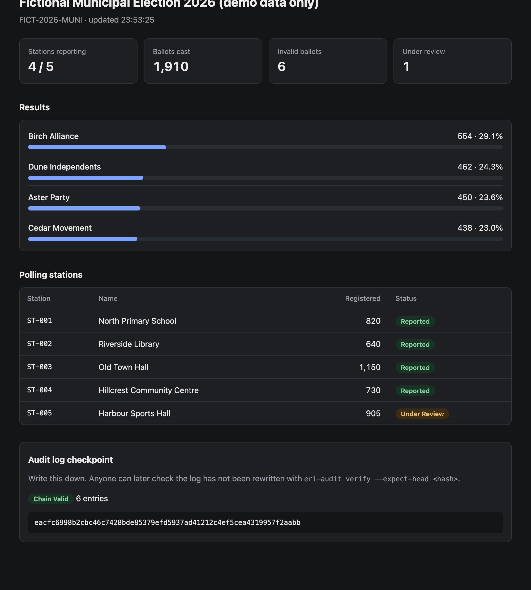
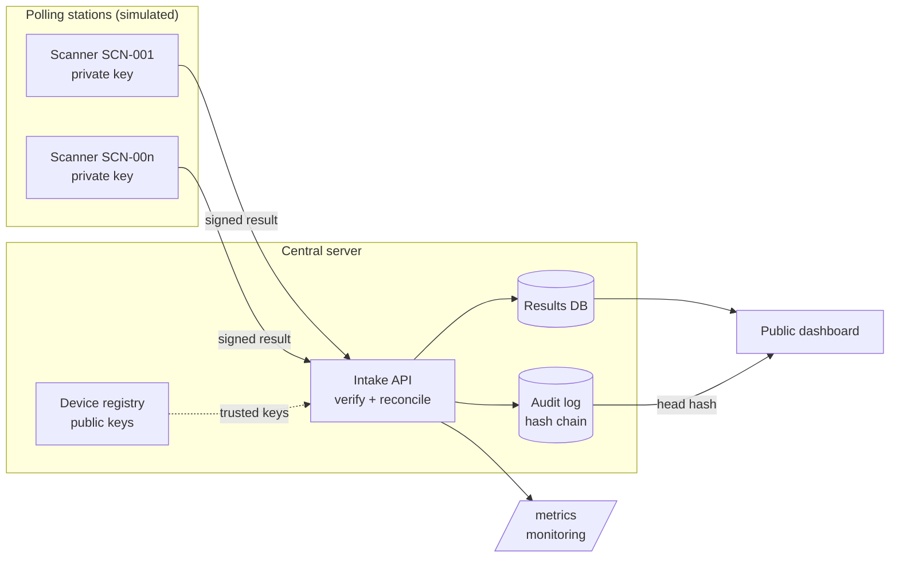

# Election Results Integrity

[](https://github.com/dzejkv/election-results-integrity/actions/workflows/ci.yml)
[](LICENSE)

A small, end-to-end election-results system designed around one question:
**how do you get numbers from polling stations to a public dashboard so that
nobody can change them along the way without it being noticed?**

> **Everything here is fictional.** The election, stations, candidates, voters and
> devices are made up. No real election data, software, documents or procedures
> from any organisation are used.



## What it does



1. **Provisioning**: each scanner gets its own Ed25519 key pair. The public key and the
   scanner's station assignment go into the server's device registry.
2. **Signed submission**: a scanner signs its result. Changing even one number afterwards
   invalidates the signature.
3. **Intake checks**: the server checks, in order, that the device is known, the signature
   matches, the payload is well-formed, the device belongs to that station, it is the
   right election, the timestamp is sane, and the message is not a replay.
4. **Reconciliation**: a correctly signed result still has to add up (votes + invalid =
   ballots cast, not more ballots than registered voters, the right candidates). If it
   doesn't, it goes to **human review** and is not counted.
5. **Audit log**: every attempt, accepted or rejected, is written to a hash-chained log in
   the same transaction as the data change.
6. **Public dashboard**: totals, station status and the current audit **head hash**,
   which anyone can note down and use later to prove the log was not rewritten.
7. **Monitoring**: Prometheus-format `/metrics` with counters per outcome and a gauge
   that drops to 0 if the audit chain breaks.

## Quick start

Requires Python 3.11+.

```bash
python3 -m venv .venv && source .venv/bin/activate
pip install -e ".[dev]"
pytest -q                 # 29 tests
./scripts/demo.sh         # full scenario, then leaves the server running
```

Then open <http://127.0.0.1:8000/> for the dashboard, `/docs` for the API and
`/metrics` for monitoring.

### What the demo shows

| Step | Scenario | Expected result |
|---|---|---|
| 3 | Four stations report honestly | `201 accepted` |
| 4 | Votes changed after signing | `401 rejected_bad_signature` |
| 5 | Scanner reports for a station it was not assigned to | `403 rejected_station_mismatch` |
| 6 | Signed numbers that don't add up | `202 flagged`, not counted |
| 7 | Correct result, then the same message replayed | `201`, then `409 rejected_replay` |
| 9 | Verify audit log against the published head hash | `ok: true` |
| 10 | Insider edits an audit entry directly in SQLite | `ok: false`, points at the edited entry |

### Running pieces by hand

```bash
eri-scanner provision --device SCN-001 --station ST-001
uvicorn --factory eri.server:create_app
eri-scanner submit --device SCN-001 --station ST-001
eri-scanner submit --device SCN-001 --station ST-001 --tamper
eri-audit verify --db data/eri.db --expect-head <hash from dashboard>
```

## Design documents

- [Architecture](docs/architecture.md): components, data flow, trust boundaries
- [Threat model](docs/threat-model.md): STRIDE analysis, what is and isn't covered
- [Design decisions](docs/adr/): why each major choice was made
- [Roadmap](docs/roadmap.md): what I would improve next

## Project layout

```
src/eri/
  crypto.py      signing, verification, canonical JSON
  models.py      strict wire format
  service.py     the intake pipeline (all checks, in order)
  reconcile.py   arithmetic checks
  audit.py       hash-chained audit log + offline verifier CLI
  store.py       SQLite storage
  server.py      HTTP API, dashboard, security headers, /metrics
  scanner.py     simulated scanner + attack modes
  static/        dashboard (no inline scripts, strict CSP)
tests/           unit and API tests
scripts/demo.sh  end-to-end scenario (also run in CI)
```

## Background

This project draws on my experience in election operations: preparing and handing
over voting equipment, validation testing, incident reporting and training. Those
tasks map directly onto security concepts (asset tracking and chain of custody,
integrity controls, incident response, validation testing), and this system is my
attempt to design those controls into software from the start.

## Transparency

Parts of this repository were written with an AI assistant. See
[AI_USAGE.md](AI_USAGE.md) for exactly which files and how.

## License

[MIT](LICENSE)
