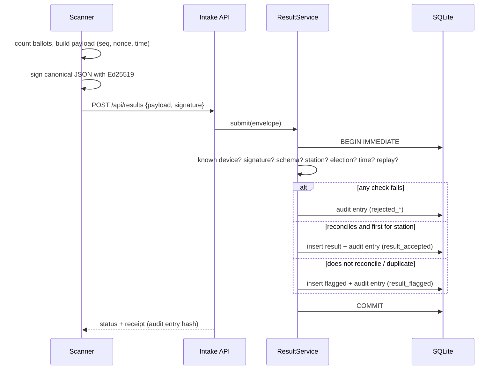
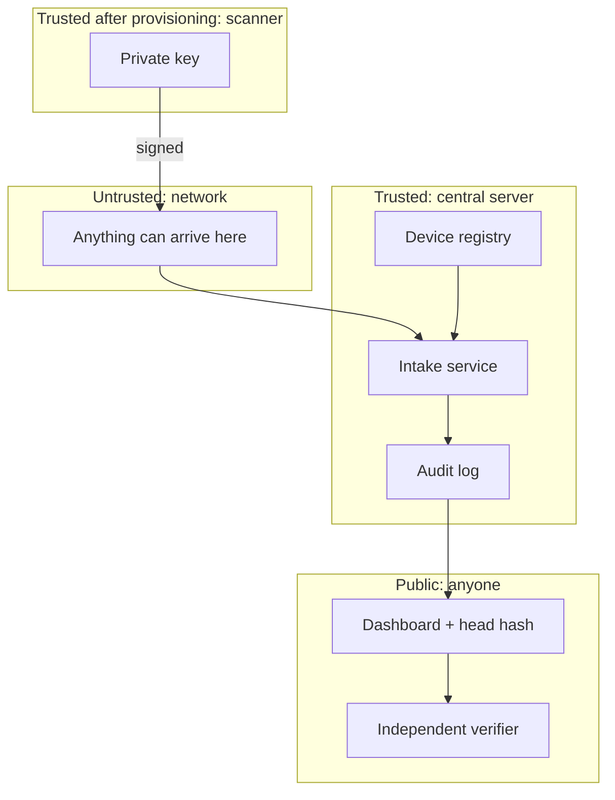

# Architecture

## Goals

1. **Integrity**: a result counted in the totals is exactly what an authorised device at
   the right station produced.
2. **Accountability**: every submission attempt leaves a record that cannot be quietly
   edited.
3. **Transparency**: the public can see totals, which stations have reported, and a
   checkpoint of the audit log.
4. **Fail safe**: anything suspicious is rejected or held for a person to review. It is
   never "fixed" automatically.

Non-goals for this version: confidentiality of individual ballots (only station-level
totals are handled), availability under attack, and a real review workflow. See the
[roadmap](roadmap.md).

## Components

| Component | File | Responsibility |
|---|---|---|
| Scanner (simulated) | `scanner.py` | Holds its private key, counts, signs, sends. Keeps a local sequence counter. |
| Device registry | `config/devices.json` | Output of provisioning: device → station, public key. The digital handover record. |
| Election definition | `config/election.json` | Candidates, stations, registered voters. The server's source of truth. |
| Intake service | `service.py` | Ordered checks, reconciliation, writes result + audit entry atomically. |
| Store | `store.py` | SQLite: `results`, `flagged`, `device_state`, `seen_nonces`, `audit_log`. |
| Audit log | `audit.py` | Hash chain; offline verifier `eri-audit`. |
| API + dashboard | `server.py`, `static/` | Public read endpoints, intake endpoint, `/metrics`, security headers. |

## Data flow for one submission

The **receipt** returned to the scanner is the hash of the audit entry written for that
submission. A station can keep it as proof of what the server recorded.

## Trust boundaries

- Nothing from the network is trusted until its signature checks out against a key in
  the registry. The signature is checked **before** the payload is parsed into a model.
- The server stores only public keys, so it cannot produce a validly signed result for
  any device.
- The public can hold the server to account: a published head hash pins the log.

## Key design decisions

Each has its own record in [`docs/adr/`](adr/):

1. [Per-device Ed25519 signatures over canonical JSON](adr/0001-device-signatures.md)
2. [Flag for human review rather than auto-correct; first accepted result is final](adr/0002-flag-dont-fix.md)
3. [SQLite with a single serialised writer](adr/0003-sqlite-single-writer.md)
4. [Hash-chained audit log with public checkpoints](adr/0004-hash-chained-audit-log.md)

## Monitoring

`/metrics` exposes:

| Metric | Why it matters |
|---|---|
| `eri_submissions_total{outcome=...}` | A spike in `rejected_bad_signature` or `rejected_replay` is an attack or a broken device. |
| `eri_stations_reporting` / `eri_stations_total` | Progress on election night. |
| `eri_results_under_review` | Work waiting for people. |
| `eri_audit_chain_valid` | Should always be 1. Page someone immediately if it is 0. |

Warnings are also logged as one JSON object per line, ready for a SIEM.
